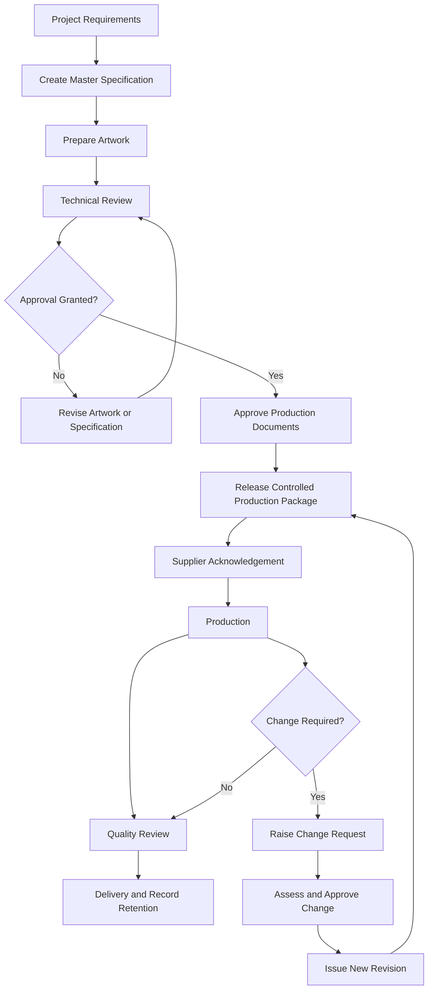

# Print Specification and Version Control Framework

**A practical framework for controlling print specifications, artwork revisions, approvals, production changes, and supplier documentation across print projects.**

[]()
[]()
[]()

---

## Overview

Print production depends on accurate information being shared between designers, clients, procurement teams, production managers, and suppliers.

A project may involve several artwork revisions, material specifications, approval stages, finishing instructions, and production requirements. When these details are managed across separate emails, documents, and supplier systems, inconsistencies can develop.

A supplier may receive an outdated artwork file. A production team may work from an earlier specification. A revised instruction may be approved internally but never reach the people responsible for manufacturing.

These problems can lead to incorrect production, wasted materials, additional costs, and delivery delays.

The **Print Specification and Version Control Framework** provides a structured approach to managing production information throughout the print lifecycle.

It establishes principles for creating specifications, identifying document versions, recording approvals, controlling changes, and distributing current production information to suppliers.

The objective is straightforward: ensure that everyone involved in a print project is working from the same approved information.

## Framework Objectives

The framework is designed to help businesses:

- Establish consistent print production specifications.
- Maintain control over artwork revisions and document versions.
- Create clear approval and production-release records.
- Prevent outdated files from being used in production.
- Document changes to materials, artwork, and production requirements.
- Improve communication between internal teams and external suppliers.
- Maintain traceability throughout the production process.
- Support repeat orders and multi-location print programmes.

## 1. Print Specification Management

Every print project should have a documented specification that defines what needs to be produced and how it should be manufactured.

Specifications should be detailed enough to guide production without leaving important requirements open to interpretation.

Depending on the product, a specification may include:

| Specification area | Information to record |
|---|---|
| Product identification | Project name, item code, product description |
| Dimensions | Finished size, format, tolerances |
| Materials | Paper stock, substrate, board, or other materials |
| Printing | Printing method, colour requirements, references |
| Artwork | File name, version, approval status |
| Finishing | Binding, lamination, coating, folding, die-cutting |
| Packaging | Packing configuration, labelling, protection |
| Quantity | Required production quantity and permitted tolerances |
| Delivery | Destination, schedule, delivery instructions |
| Quality | Inspection requirements and acceptance criteria |

Specifications should be reviewed whenever product requirements or production conditions change.

### Master Specification Principle

Each project should have an identifiable master specification.

This document acts as the primary reference for production requirements. Supporting documents, artwork files, proofs, and supplier instructions should refer back to the relevant specification and revision.

## 2. Artwork Version Control

Artwork control is essential when projects involve multiple revisions, reviewers, and production locations.

Every artwork file should have a clear identity and revision history.

### Recommended File Naming Convention

```text
ProjectName_ItemCode_Artwork_v01_Draft.pdf
ProjectName_ItemCode_Artwork_v02_Review.pdf
ProjectName_ItemCode_Artwork_v03_Approved.pdf
ProjectName_ItemCode_Artwork_v04_Released.pdf
```

The naming convention should make it possible to identify:

- The project or product.
- The relevant item or specification.
- The artwork revision.
- The document status.

### Document Status Definitions

| Status | Meaning |
|---|---|
| Draft | Work in progress; not approved |
| Under Review | Submitted for checking or approval |
| Approved | Content and design approved by the authorised reviewer |
| Released | Approved file formally issued for production |
| Superseded | Replaced by a newer revision |
| Withdrawn | Removed from active use |

Approval and production release are separate controls. A file should only be treated as production-ready when the required release conditions have been met.

### Version Control Rules

1. Assign a unique revision identifier to each controlled change.
2. Never overwrite an approved production file without retaining its history.
3. Record the reason for each revision.
4. Identify the person responsible for preparing and approving changes.
5. Clearly mark superseded files.
6. Distribute only the current released version for production.
7. Retain previous revisions according to the organisation's document-retention policy.

## 3. Approval and Production Release

Approval records provide evidence that the relevant people have reviewed and accepted the production information.

A controlled approval process should identify:

- The document or artwork being reviewed.
- Its revision number.
- The responsible reviewer.
- The approval date.
- Any conditions or outstanding issues.
- The production-release decision.

### Approval Stages

A typical workflow may include:

1. Artwork preparation.
2. Internal technical review.
3. Client or brand approval.
4. Proof review, where required.
5. Final production approval.
6. Controlled release to the supplier.

The approval process should reflect the complexity and risk of the project.

A routine repeat order may require fewer review stages than a new packaging design involving several materials, finishes, and production locations.

### Production Release Control

Suppliers should receive a clearly identified production package containing the current approved specification, released artwork, relevant proofs, and applicable production instructions.

The release record should identify exactly which documents and revisions have been issued.

## 4. Specification Change Management

Changes are a normal part of print production. Artwork may be revised, materials may become unavailable, dimensions may change, or delivery requirements may be updated.

The important issue is ensuring that changes are reviewed, approved, documented, and communicated before they affect production.

### Change Management Requirements

Each significant change should record:

| Field | Purpose |
|---|---|
| Change reference | Unique change identification |
| Project or item | Identifies the affected product |
| Current revision | Existing approved version |
| Proposed revision | New or amended version |
| Change description | What is being changed |
| Reason for change | Why the change is necessary |
| Impact assessment | Effects on cost, quality, schedule, and materials |
| Approval | Authorised decision |
| Implementation date | When the change becomes effective |
| Supplier notification | Confirmation that relevant suppliers were informed |

### Change Impact Assessment

Before approving a change, consider whether it affects:

- Artwork and brand presentation.
- Materials and substrate availability.
- Printing method or finishing.
- Production cost.
- Existing inventory.
- Supplier capability.
- Production and delivery schedules.
- Products already in production or distribution.

A change should not be treated as complete until the affected documentation has been updated and the relevant parties have received the new instructions.

## 5. Supplier Documentation Control

When multiple suppliers participate in a print programme, document consistency becomes particularly important.

Each supplier should receive the current information relevant to its responsibilities.

A controlled supplier handoff should include, where applicable:

- Current master specification.
- Released artwork files.
- Approved proofs.
- Material and finishing requirements.
- Quality inspection criteria.
- Packaging and labelling instructions.
- Delivery requirements.
- Relevant change notifications.

Suppliers should be able to identify which files are current and which have been withdrawn.

The business should also maintain a record of what was issued, when it was issued, and to whom.

This reduces the risk of different suppliers working from different versions of the same production requirements.

## 6. Document Storage and Traceability

Controlled production documents should be stored in an organised location accessible to authorised users.

The document-control system should make it possible to identify:

- The current approved specification.
- The latest released artwork.
- Previous revisions.
- Approval records.
- Change requests.
- Supplier distribution records.
- Production-release documentation.

Access permissions should reflect the responsibilities of the people involved.

Working files, approved files, and superseded documents should be clearly distinguished. Avoid relying on informal email attachments as the only record of the production version.

For businesses operating internationally, consistent naming conventions and document structures help teams locate the correct information across different locations.

## 7. End-to-End Document Control Workflow

The following workflow illustrates how production information moves through a controlled print project.



The workflow should be adapted to the organisation's approval structure, supplier arrangements, and production requirements.

## 8. Practical Example: Managing a Packaging Artwork Revision

Consider a business producing printed cartons through an external supplier.

The original packaging artwork has been approved and released. Before the next production run, the business updates the product information and changes a small element of the design.

A controlled process would involve:

1. Recording the requested change.
2. Identifying the existing approved artwork revision.
3. Preparing the revised artwork.
4. Checking dimensions, colours, dielines, and finishing requirements.
5. Obtaining the required approval.
6. Assigning a new revision identifier.
7. Releasing the updated production file.
8. Notifying the supplier that the previous version is superseded.
9. Confirming that production will use the newly released file.
10. Retaining the change and approval records.

The purpose is to ensure that the supplier does not continue using the previous artwork and that the revised packaging meets the agreed requirements.

## 9. Governance and Responsibilities

Document control works best when responsibilities are clearly assigned.

| Role | Main responsibility |
|---|---|
| Project Owner | Defines project requirements and overall accountability |
| Design Team | Prepares and revises artwork |
| Technical Reviewer | Checks production specifications and file requirements |
| Brand or Client Approver | Approves design and content |
| Print Procurement | Coordinates supplier requirements and commercial information |
| Production Manager | Confirms production readiness |
| Supplier | Works from released documentation and reports discrepancies |
| Document Controller | Maintains revision history and controlled records |

In smaller organisations, one person may perform several of these responsibilities. Approval and release authority should still be clearly defined.

## 10. Performance and Control Measures

Businesses can review the effectiveness of their document-control process using practical operational measures.

Suggested indicators include:

| Measure | What it helps identify |
|---|---|
| Artwork error rate | Frequency of artwork-related production problems |
| Outdated-file incidents | Use of superseded production information |
| Approval turnaround time | Time taken to complete required approvals |
| Change implementation time | Time between approved change and supplier implementation |
| Reprint incidents | Production losses associated with incorrect information |
| Specification compliance | Whether production follows agreed requirements |
| Supplier document compliance | Whether suppliers use the correct released documents |

These measures should be interpreted in the context of project complexity and production volume. Their purpose is to identify recurring problems and opportunities for improvement.

## Implementation Checklist

Use this checklist when establishing or reviewing a print specification and version-control process.

- [ ] Establish a master specification for each controlled print product.
- [ ] Define required specification fields.
- [ ] Create a consistent artwork naming convention.
- [ ] Establish document status definitions.
- [ ] Assign approval and release responsibilities.
- [ ] Maintain an artwork revision register.
- [ ] Introduce a formal change-request process.
- [ ] Record supplier document distribution.
- [ ] Identify and withdraw superseded files.
- [ ] Maintain accessible approval and production records.
- [ ] Review document-control performance periodically.

## Repository Structure

```text
print-specification-and-version-control/
│
├── README.md
│
├── specifications/
│   ├── print-specification-template.md
│   └── specification-checklist.md
│
├── artwork-control/
│   ├── artwork-naming-convention.md
│   ├── artwork-version-register.md
│   └── document-status-guide.md
│
├── approvals/
│   ├── approval-record-template.md
│   └── production-release-checklist.md
│
├── change-management/
│   ├── change-request-template.md
│   ├── change-impact-assessment.md
│   └── change-log-template.md
│
├── supplier-documentation/
│   ├── supplier-handoff-checklist.md
│   └── document-distribution-register.md
│
├── workflows/
│   └── production-document-control.md
│
├── examples/
│   └── packaging-artwork-revision.md
│
└── LICENSE
```

## Intended Applications

The framework is relevant to organisations managing:

- Commercial print production.
- Packaging and product labels.
- Branded merchandise.
- Marketing and promotional materials.
- Multi-supplier print programmes.
- International print projects.
- Repeat production and reordering.
- Multi-location brand and production operations.

## Expected Business Benefits

A consistent approach to print specification and version control can help businesses:

- Reduce errors caused by outdated artwork.
- Improve the accuracy of production instructions.
- Prevent unapproved changes from reaching suppliers.
- Improve accountability throughout the approval process.
- Reduce avoidable reprints and production delays.
- Improve supplier communication.
- Maintain consistent production standards across locations.
- Establish a reliable record of production decisions.

## Scope and Use

This repository provides an operational framework and example documentation structure. It is intended to be adapted to the requirements, systems, approval policies, and risk levels of
